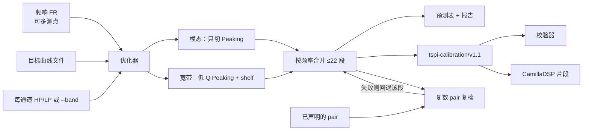

# 技术方案

状态：**已定稿（2026-11-16）**。实施任务见同目录 `tasks.md`。

分频器设计、类 Dirac ART 的 MIMO 系数不在本方案里。分频点只作为输入；MIMO 引擎与 channelmap v2.1 维持原任务。

## 1. 架构

生产者仍是现有的 `tspi-calibrate` 单二进制。优化器插在「已有频响」和「校准 YAML」之间。测量、延迟、极性沿用现在的 `analyze` / `merge`。



目标函数对所有通道相同：最小化 `w(f)·(FR(f) + ΣH(f) − target(f))`。`H` 是双二阶的幅度。程序不再提供「让 ΣH 去模仿实测」的拟合。

## 2. 技术选型

| 项 | 选择 |
| --- | --- |
| 语言与载体 | 只使用 `calibrate/` 的 Rust 二进制，不新增 crate，不新增、不调用 Python。 |
| 滤波器 | Peaking、low_shelf、high_shelf。不引入 FIR，不调用 MIMO 引擎。 |
| 目标曲线 | 独立 YAML（`tspi-target-curve/v1`），只进拟合和报告。 |
| 契约 | 新文件写 `tspi-calibration/v1.1`。无 `type` 的旧文件仍按 Peaking 读取。 |
| 校验 | `tspi-calibrate validate` 与 `check-pair`。公式放在独立模块 `check.rs`，拟合代码不能调用它来凑答案。 |
| 渲染 | `calibrate` 的 CamillaDSP 片段按 type 映射。Web 本地校验同步放宽。仓库外的 Python 渲染器 `tspi-channelmap` 不在本方案中调用。 |

CamillaDSP 映射：`type: Biquad`，`parameters.type` 为 `Peaking` / `Lowshelf` / `Highshelf`，字段 `freq`、`q`、`gain`。

## 3. 模块

| 文件 | 职责 |
| --- | --- |
| `calibrate/src/target.rs` | 读曲线、校验频率递增且 dB 有限、对数频率上线性插值。内置 `flat`。 |
| `calibrate/src/modal.rs` | 1/24 oct 平滑、突出度、−3 dB 带宽估 Q、只切、测点一致性、相距 <1/6 oct 合并。 |
| `calibrate/src/peq.rs` | 去掉「模仿实测」。宽带贪心、shelf、倍频程平滑、复数 `H(f)`、预测残差。求值函数不再把 Q 夹到 10、增益夹到 ±18。 |
| `calibrate/src/dsp.rs` | `fr_from_h` 接受点数或 1/N oct；缺省仍 300 点。另写模态用的更密频响。 |
| `calibrate/src/model.rs` | `Peq` 增加 `type`（缺省 `peaking`）。校准 `schema` 允许 v1.1。 |
| `calibrate/src/main.rs` | `fit` / `merge` 改为校正。pair 检查把双二阶相位加进 `channel_h`。写出预测表和 `optimizer` 报告。 |
| `calibrate/src/check.rs` | 独立实现契约校验与 RBJ 复数响应，供 `validate` / `check-pair` 和对拍测试。 |
| `calibration-spec/CONTRACT.md` | 增加 v1.1，并写明校验命令是 `tspi-calibrate validate`。 |
| `web/src/channelmap.rs` | `PeqBand` 增加可选 `type`；v1.1 时 Q 不再卡 10，type 只允许上述三种。 |

`fit_synthetic_peaking` 现在断言滤波器复现实测，改为断言叠回实测后靠近目标。

## 4. 算法

### 4.1 频带

每个通道的工作频带来自 `--band 低:高`，或来自调用者给出的 HP/LP。未给出时工作频带不额外收窄。

- 模态搜索带 = `[20, 250]` Hz 与工作频带的交集。交集为空则该通道没有模态段。
- 宽带搜索带 = `[80, 16000]` Hz 与工作频带的交集。高通以下不放段。

这些缺省范围是参数，不是某一套分频的写死表。调用者把分频点传进来。

### 4.2 模态

在 1/24 oct 平滑后的幅度上找局部峰。突出度 = 峰值 − ±1/3 oct 内左右两侧最低点的较高者，低于 3 dB 丢弃。谷不生成滤波器。不用邻域中位数：宽峰的肩会抬高中位数，Q≈4 的峰再高也过不了 3 dB。

两个及以上测点时：加权幅度平均上的突出度低于 2 dB，或同向测点少于 2 个，则丢弃。测点间偏差大于 6 dB 的频点降权。只有一个测点时仍输出，报告里模态置信度为 `low`。

Q 由 −3 dB 带宽反算，下限 0.1。不把 Q 夹到 10。带宽窄于该网格一个频点时，Q 取网格能表示的最细值，并标 `q_unresolved`。

增益 `g = −min(12, prominence − 1)` dB，不为正。相距小于 1/6 oct 的峰合成一段：增益取更深、Q 取更高。每通道至多 10 段。

### 4.3 宽带

输入是 1/6 oct 平滑后的空间平均。多测点时先功率平均再开方；权重缺省：名为 `listening` 的测点为 1，其余 0.5；只有一个测点时权重为 1。

先尝试最多一个 `low_shelf` 和一个 `high_shelf`（Q = 0.7），只在目标相对平直形状的整体倾斜超过 1 dB 时加入。然后再做 Peaking：Q 候选 0.3–2.0，频率网格 1/12 oct，每步取加权误差下降最大的增益。单段增益绝对值 ≤ 6 dB。

停止条件：残差 RMS < 0.5 dB，或宽带段数达到 12（shelf 计入），或下一步增益绝对值 < 0.2 dB。

与已有模态段相距小于 1/6 oct 的候选不再使用。

正向增益总和 ≤ `--boost-cap-db`，缺省 0。参数大于 +3 时按 +3 执行并 warning。模态段不吃这份额度，模态段始终 ≤ 0。

调用者用 `--match FL,FR` 这类参数声明匹配组。组内 1/3 oct 预测差 > 3 dB 时，用联合权重重拟合一次；仍超差只 warning。未声明匹配组则不做左右绑定。

### 4.4 合并与回退

模态段先按频率排序，再并入宽带段，总段数 ≤ 22，再按频率升序写入。写出前用求值函数重算预测。

若调用者声明了 pair：每接受一段，就把双二阶的复数响应加进现有 pair 判据（Δφ、CD、陷波、纹波）。失败则丢掉该段并记入 warnings。未声明 pair 时不做回退。现有 `channel_h` 只加了幅度，本方案补上相位。

预测表列：频率、目标、预测、各测点预测、残差。报告增加 `optimizer`：`mode`、`target`、`stages_modal`、`stages_broadband`、`predicted_rms`、`predicted_max`、`warnings`。

## 5. 接口

`fit` 与 `merge` 共用同一套优化参数：

```text
--target flat|id|@file          缺省 flat
--band 20:250                  可重复，或与通道名一起：FL=80:16000
--hp / --lp                    工作频带边界；来自分频，不在程序内选择分频
--boost-cap-db 0               缺省 0，有效上限 +3
--positions DIR                子目录为测点名；没有则把现有 analysis 当作 listening
--match FL,FR                  可重复
--pairs A:B:fc,...             沿用现有 pair 语法；给出才做回退
--fr-points N / --fr-oct 1/48  作用在 analyze；fit 使用已写好的频响
```

没有这些参数时，`fit` / `merge` 仍然做校正：目标 `flat`，宽带默认不抬，模态在缺省搜索带里只切。这替代现在的模仿实测。

测点目录：`<run>/positions/<name>/*.analysis.json`，analysis 增加 `meta.position`（名称、可选权重）。SNR < 25 dB（200 Hz–8 kHz）或峰值 > −1 dBFS 的测点标 `invalid`，不进入拟合。

## 6. 契约 v1.1

在 `CONTRACT.md` 增加一节，不改 v1 已发布字段的含义。

- `schema: tspi-calibration/v1.1`
- `filters[].type`：`peaking`（缺省）、`low_shelf`、`high_shelf`。其他值整份拒绝。
- `filters[].q`：有限且 ≥ 0.1。不再把 10 当作 v1.1 的上限。
- 单段 gain 仍是 ±24 dB，每通道仍 ≤ 32 段，trim 仍是 −12..+6。
- 只含 Peaking 且 Q ≤ 10 的 v1.1 文件，校验器同时注明「v1 消费方可读」。含 shelf 或 Q > 10 的文件，未升级的 v1 消费方整份拒绝。
- 目标曲线不进入校准文件。

本仓库内的消费方是 Web 本地校验和 `calibrate` 的片段，两者都是 Rust。契约里的校验步骤改为 `tspi-calibrate validate`。现有 `validate_calibration.py` 与 `check_pair_response.py` 不再作为本功能的验收入口。

## 7. 测试

合成夹具放在 `calibrate` 的单元测试里，频率和 Q 由夹具给定。

| 用例 | 通过条件 |
| --- | --- |
| 8 个已知模态 + 倾斜 + 噪声，其中至少两个 Q > 10 | 频率 ±3 Hz，Q ±30%，模态增益 ≤ 0，Q>10 保持为估计值 |
| 网格分辨不开的窄峰 | `q_unresolved`，Q 等于网格最细值 |
| 深谷且 boost cap = 0 | 无正增益段 |
| `flat` 与一条非平直曲线 | 1/6 oct 残差 RMS ≤ 1 dB，段数不超预算 |
| 声明 pair 且某段破坏 Δφ | 该段被回退 |
| `tspi-calibrate validate` | v1 旧文件仍按旧规则；v1.1 shelf 与 Q>10 通过；未知 type 失败 |
| 求值对拍 | `peq.rs` 与独立的 `check.rs` 对同一组系数，幅度差 ≤ 0.1 dB。CamillaDSP 文件后端在本机有该二进制时再跑同一阈值 |

## 8. 安全与边界

程序只读写调用者给出的本地路径，不监听网络。增益在写出前落在契约的 ±24 dB 内，段数不超过 22（契约上限 32）。目标曲线和测点权重只出现在报告里，不进入会被渲染器执行的字段。

不在本方案中实现：分频阶数或频率的自动选择、输入×输出 FIR、多低音联合优化。
