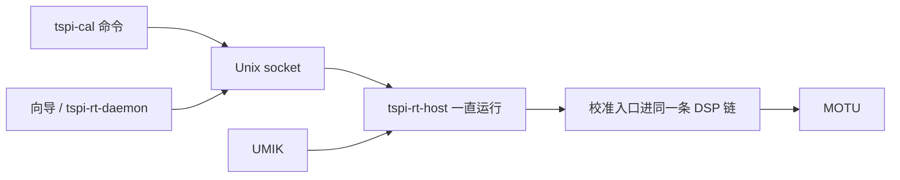

# 技术方案

状态：**已确认并已实施（2026-11-23）**。任务见 `tasks.md`。

需求见同目录 `requirements.md`。皇帝位的求解和通过线仍以 `specs/emperor-focus/` 为准。本方案只规定三个程序怎么接。

## 1. 结论

这是一套客户端/服务端。服务端只有 `tspi-rt-host`：它一直运行，占着 MOTU，听 Unix socket。前台命令 `tspi-cal` 像 `docker` 那样连上、做完一件事、打印结果、退出，自己不占声卡。网页是另一个客户端：浏览器连 `tspi-rt-daemon`，daemon 把同一次请求转到同一只 socket，自己也不占声卡。两个客户端没有各自的校准状态，状态只在 host 里。

用户说的校准播放和录音留在 `tspi-rt-host` 里。进程不退出。`TSPI_CAL_JOB_BACKEND=real` 时 daemon 发这些请求，不再对这次任务返回 503。socket 不在时，命令和网页都失败，不在本地另开一套播放。

校准入口是和 AES67 并列的一种 capture 源。进入校准模式后，AES67 和其他节目输入停在 DSP 链之外，扫频按块送进同一条 graph、侧路和 ALSA。求解在 host 的非实时线程里调用已经落地的 `emperor` 库和目标 FIR。

低频复测保持 plan 恒等并打开侧路。全频复测关掉侧路，把 `P_post` 换成目标 FIR。两次切换都在进程内完成。侧路打开时 `P_post` 仍必须是恒等，所以这两套系数不同时生效。

操作页面用现有的 Dirac 式 8 步向导 `web/demo/dirac-style-flow`。daemon 提供这套页面，向导里的测量、求解和复测通过 socket 发给 host。双击打开时仍可读 `pilot.json` 做演示。从 daemon 打开时，这三步读真实任务，不再播演示动画。

`nsp16` 不另留一套程序。实现时只读对照板上的 unit 和 toml，把 16 声道播放仍需要、仓库通用部署里还没有的项写进 `tspi-rt-host` 的部署文件。服务名用 `tspi-rt-host`。soak 期间只改仓库。

## 2. 校准入口

host 增加一路进程内的虚拟输入，capture 源名叫 `cal`。它的位置和现有 `aes67`、`file` 相同：音频线程每次取 128 点，送进同一条 DSP 链，再从 MOTU 播出去。扫频由 host 写进这条虚拟输入，不经过 aplay，也不另开声卡。块时钟用 MOTU 播放的那一个，虚拟输入不自带时钟。UMIK 只在校准模式里由 host 打开。

这条虚拟输入不做内核回环设备。板上是 Linux，再加一块 loopback 声卡会多出一个时钟，扫频和播放对不齐。

socket 缺省路径是 `/run/tspi-rt-stack/host.sock`，测试可以改。请求至少有：`enter`、`measure`、`solve`、`remeasure`、`leave`。`enter` 和 `remeasure` 在真实设备上必须带出声确认，否则 host 不切换输入。前台就是这些短命令：`tspi-cal enter`、`tspi-cal measure`、`tspi-cal solve`、`tspi-cal remeasure`、`tspi-cal leave`。每条连上 socket，送出同名请求，读完结果后退出。网页的每一步发的是同一组请求，不另定一套动作。

`measure` 在同一次校准模式里扫两遍，各写各的脉冲响应。对数扫频的时间按倍频程均分，5 秒的 20–20000 Hz 里，150 Hz 以下大约只有 1.5 秒；同样 5 秒只扫 20–500 Hz，这段大约有 3 秒。衰减要看到 −25 dB 或 −35 dB，用全频扫频的低频段不够。所以 20–500 Hz 只进 `design_channel`，20–20000 Hz 只用来设计目标 FIR。

4.1.2 的播放通道固定为 0、1、2、3、4、5、7，名字为 FL、FR、SL、SR、HFL、HFR、SUB1。从喇叭由请求里的 `supports` 给出，缺省为空。`f_hi` 缺省 150，大于 150 由库拒绝。

`solve` 在非实时线程里做两件互不代入的事：调用 `emperor::design_channel` 求侧路系数；调用现有 `fit_peq`，只留下目标 FIR。皇帝位代价、抽头上限和增益上限不改。音频线程不跑这个求解。

反卷积用现有 `ir_extract::deconvolve`。每个声道把主喇叭和选中的从喇叭交给 `design_channel`。侧路导出只含修正：对角是 `g_pp`，未选中的从路径不写。这份系数不进入目标 FIR，也不进入现有 SolveG。

目标 FIR 走现有 `fit_peq` 里的线性相位 `P_post`。向导的目标曲线缺省 flat，选了 tilt10 就用 tilt10。同一次拟合里如果还算出模态段或宽带段，这次丢掉，不导出、不播放、不写入 plan。向导上的低切仍只用来对照实测滚降并给出原来的警告，不生成分频滤波器，也不读取实验路径里的 crossover 节。

复测仍用校准入口进链。低频两次都是恒等 plan：第一次侧路系数为空，第二次装上这次的 `g`。全频两次都关掉侧路：第一次 `P_post` 为恒等，第二次换成目标 FIR。衰减结论只比较低频那一对，取 `FIELD_SHORTER`、`FIELD_NOT_SHORTER`、`FIELD_UNFALSIFIABLE` 之一。全频那一对只作为频响对照。预测衰减比写进报告，不写进这个结论字段。

`summary.json` 至少包含 `verdict`、`synthetic`、`f_hi`、`supports`、`metric`、`engine_playable`、`target`、`target_fir_taps`。没有真实设备时 `synthetic=true` 且 `verdict=PREDICTED_ONLY`。真实采过音时 `synthetic=false`。

## 3. daemon 与网页

`CalBackendMode::Real` 改为连接 host 的 Unix socket，不再返回「未接线」。这个 port 接受 `kind=emperor`。`kind=full` 和 `kind=retest` 在 real 模式下仍返回 400，原来那条独立闭环不从这里重跑。`synthetic` 和 `cli` 两种旧模式保持现在的行为。socket 连不上时，real 模式返回 503，并且不伪造一次测量。

daemon 用 `TSPI_HOST_SOCK` 找到 socket，缺省 `/run/tspi-rt-stack/host.sock`。它自己不打开声卡，也不调用 `systemctl restart`。进度读 host 写在任务目录里的 `status.json`，结束读 `summary.json`。向导上的结论字段就是 `verdict`。`synthetic=true` 的回执继续显式带出，向导沿用现有的「实测 / 示意 / 目标」分列，不把示意曲线显示成 MOTU 已经在播这套系数。

`CAL_JOB_KINDS` 增加 `emperor`。`POST /api/calibration/jobs` 在现有字段外接受：

| 字段 | 作用 |
| --- | --- |
| `audible_sweep_authorized` | 已有。real 模式下不为 true 就 400，并且不停 host |
| `f_hi` | 缺省 150，大于 150 为 400 |
| `supports` | 字符串数组，缺省空。名字必须在 FL、FR、SL、SR、HFL、HFR、SUB1 里 |
| `target` | `flat` 或 `tilt10`，缺省 `flat`。只在 `stage=solve` 时读取 |

daemon 不再按 `TSPI_CAL_BIN` 去拉起一个会自己播声的 `tspi-cal`。`POST` 增加 `stage`，取 `measure`、`solve`、`remeasure`。`solve` 才需要 `f_hi` 和 `supports`。`measure` 与 `remeasure` 在 real 模式下还要 `audible_sweep_authorized=true`。这些字段原样送到 socket。

向导八步和这次任务的关系：

| 步 | 页面上已有的内容 | 这次怎么接 |
| --- | --- | --- |
| 1 设备 | MOTU、UMIK、线序、服务 | 改读 daemon 的设备与 host 状态 |
| 2 布局 | 4.1.2 七角色到 MOTU | 原样作为通道表，不另做一套 |
| 3 电平 | UMIK、噪底、逐通道电平 | 保留。本路径只使用皇帝位这一只麦，电平 −12 dBFS |
| 4 测点 | 听音位加多点，ART 至少 3 点 | 本路径只点亮皇帝位。多出来的点和 ART 的 3 点要求留在页面上，这次任务不测它们，也不因此拒绝 |
| 5 测量 | 扫频进度 | 按下后发 `stage=measure`。host 进入校准模式，先扫 20–500 Hz，再扫 20–20000 Hz，进度来自 `status.json` |
| 6 分析 | 频响、瀑布、低频 RT60、模态 | 瀑布和衰减改画这次低频测量。全频频响改画 20–20000 Hz 那一遍。模态表留在页面上，这次不填 IIR |
| 7 设计 | 目标曲线、低切、ART、MIMO | 目标曲线 flat / tilt10 只用来出目标 FIR。低切继续只做滚降警告。ART 留在页面上，不进任一代价。MIMO 区改成支援频段上沿和从喇叭勾选，缺省不勾选。按下后发 `stage=solve` |
| 8 回顾 | 应用前确认、导出、回滚 | 应用前确认发 `stage=remeasure`。host 用校准入口走 DSP 链，分开给出衰减结论和频响对照。导出侧路系数和目标 FIR。回滚发 `leave`，恢复原来的输入 |

`web.rs` 里现有的 full / retest 按钮保持原请求。皇帝位不在那两个按钮上另开入口。向导源文件仍在 `web/demo/dirac-style-flow`，由 daemon 提供页面。

## 4. 校准模式

切换放在 host 里，不复用 `calibration_cli_stage.rs` 的 `CliSafety`。那份实现会 `systemctl stop/start`，而且面向 PEQ 的 `calib-stage.sh`。这次不重启 host，也不为校准去抢 MOTU。

`enter` 做三件事：记下当前 capture 源；停掉 AES67 和节目输入，使它们的样本到不了 DSP；打开 UMIK，并把 capture 源改成 `cal`。MOTU 播放保持由本进程打开。

`leave` 关掉 UMIK，capture 源改回进入前的值。改不回去时，回执 `playback_restored=false`，向导第 8 步标明播放未恢复。不改该 unit 的环境，不写 `90-safe-mute.env`。

低频复测和全频复测都留在 `cal` 源上。换的是图：侧路开关和 `P_post` 是恒等还是目标 FIR。换图期间继续丢掉 AES67 样本。两次复测结束前不自动 `leave`。

soak 未结束时，本仓库的安装脚本和这条命令都不连接 sender-host、N150、MOTU。单测用进程内的假设备和一对 socket。

## 5. 收回 nsp16

仓库里没有 `nsp16` 文件。实现的第一步是只读读取板上的 `/etc/systemd/system/tspi-rt-host-nsp16.service` 和 `/etc/tspi-rt-stack/rt-host-nsp16.toml`，与 `rt-stack/service/tspi-rt-host.service` 以及现有 host 配置模板对照。

收进 `tspi-rt-host` 部署文件的，是当前 16 声道播放仍依赖、而通用模板里没有的项，例如双流 AES67、plan、声卡和通道散开。只改了服务名的行不收。只属于 `deploy/config/tspi-rt-host-nsp7.service` 的项不收，nsp7 文件保持原样。

对照结果写到 `rt-stack/deploy/NSP16-FOLD.md`：收进来的项、故意不收的项。读不到板上的文件就停在这一步，不凭记忆补一份 toml。不 `systemctl` 正在跑的 `tspi-rt-host-nsp16`，不替换 `/opt` 里的二进制。

## 6. 测试

`TEMP`/`TMP` 指向 `C:/WorkSpace/Claw/scratch/lead/testtmp`。

| 范围 | 断言 |
| --- | --- |
| `tspi-cal emperor solve` 连到假 socket | 写出 `g_pp` 和 `target_fir_taps`。不写出 IIR 段。`verdict=PREDICTED_ONLY`，`synthetic=true`。侧路系数不进目标 FIR。命令随后退出。 |
| 真实设备请求缺出声确认 | host 保持原来的 capture 源，不打开 UMIK。 |
| daemon real，假 socket | `stage=measure` 与 `stage=remeasure` 都会让 host 进入校准模式，并且不调用 `systemctl`。已授权时回执带 host 写出的 verdict，`synthetic=false`。 |
| daemon real | `kind=full` 为 400。socket 可用时 `kind=emperor` 不再是 503。 |
| 向导 | 从 daemon 打开时，第 5、7、8 步分别提交 `measure`、`solve`、`remeasure`。第 4 步只有皇帝位也会进入测量。ART 衰减和 0…−24 dB 的示意滑杆不出现在求解请求里。 |
| daemon synthetic | `kind=emperor` 的回执 `synthetic=true`，verdict 不是 `FIELD_SHORTER`。 |
| host | 校准模式中，AES67 块到不了 DSP。`leave` 之后恢复进入前的源。 |
| 复测 | 低频两次的块计数表明扫频经过了侧路所在的同一条链。全频两次的侧路为关，第二次 `P_post` 不是恒等。 |

声学复测本身不在这些测试里宣称通过。现场仍是未测，直到同一只麦在房间里跑完。
